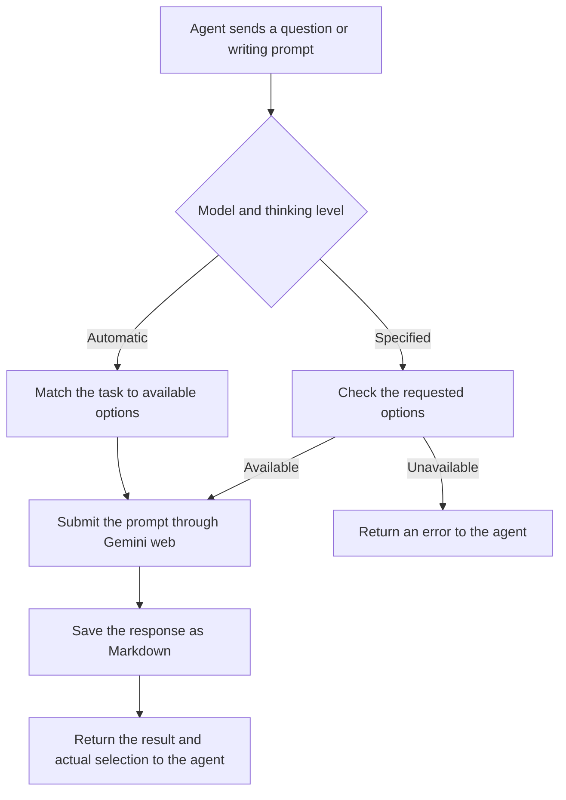

# ask-gemini-web

[English](README.md) | [简体中文](README.zh-CN.md) · [MIT](LICENSE)

Let your agent ask questions or draft text through your Gemini web account. The skill selects a model and thinking level for the task and saves the result as Markdown.

Built for web Q&A and drafting that preserve your agent-plan quota by moving the main generation to Gemini web. Also for users whose region does not support the Antigravity app but who can access Gemini web. Gemini web's own eligibility and usage limits still apply; agent coordination may use some agent quota.



## Install with your agent

Copy this request into your agent chat.

> Install ask-gemini-web from https://github.com/thweki/ask-gemini-web and use my Gemini web account to write an article about urban gardens. Choose the model and thinking level for the task and ask me to sign in when needed.

Your agent handles setup and execution. You sign in directly at Google inside the selected Chrome browser. Login persists in a local profile across restarts, though Google may occasionally require verification. No API key is needed; standard Gemini web usage limits apply.

## For agents

Install from a fresh checkout with Node.js 22.12 or later.

```sh
git clone https://github.com/thweki/ask-gemini-web.git
cd ask-gemini-web
npm ci
npm run build
npm run install:skill
```

For an existing installation, use `npm run install:skill -- --update` in the last step. Load [SKILL.md](skills/ask-gemini-web/SKILL.md), resolve the bundled runner, and make one call with a UTF-8 JSON job file (preferred on Windows):

```text
node <skill>/scripts/ask-gemini-web.mjs run job.json
```

```json
{"prompt":"Write a short article about urban gardens."}
```

```text
draft({ prompt, model?, thinking?, task? }) → { id, state, promptSha256, result, selection }
```

Omitted options use local task routing against live web capabilities. Explicit parameters take priority and fail if unavailable (e.g., `"model":"Gemini 4 Hydrogen","thinking":"medium"` pins both). Browser startup, selection, submission, and saving run inside this single call without an extra model-driven browser loop.

`run --stdin` remains available for UTF-8 pipes. PowerShell 5.1 can silently replace Chinese with `?` before Node receives it; use a file on Windows. The returned `promptSha256` identifies the rendered prompt. `--compact`/`--json` keep stderr free of progress; `--quiet` suppresses progress in human mode.

Load references only as needed: [setup/API/recovery](skills/ask-gemini-web/references/api.md), [routing policy](skills/ask-gemini-web/references/routing.md), or [dated benchmark evidence](skills/ask-gemini-web/references/benchmarks.md). Do not prepend diagnostic calls to ordinary drafting. Preview with `plan`; recover uncertain submissions with `resume <id>`, never a new run. Follow the host's normal permission flow for local Chrome/CDP access.

Requires Node.js 22.12+, Chrome, and Gemini access. The installer provides independent runtimes for Codex and Agent Skills directories. Only install-time CDP flags/environment variables pin the skill to an explicit endpoint; ordinary installs and older unmarked connections allow discovery after updates. See the API reference for saved connection details. Profiles and saved task records stay local and are excluded from release packages—never export passwords or cookies.

Supports standard single-turn text and basic Markdown. Canvas, Deep Research workflows, binary uploads, and exact regeneration are outside this version. Verified on Windows, Chrome 157, and Chinese Gemini UI; other environments may need adapter updates. Licensed under [MIT](LICENSE).

An explicit CDP address (`--cdp`, `ASK_GEMINI_WEB_CDP`, or the legacy `GEMINI_DRAFT_CDP` fallback) selects only that browser. If unreachable, it fails with `CDP_UNAVAILABLE` (exit 2) without discovery, launch, or changes to `connection.json`: start Chrome at that address, or remove the option/environment variable to use auto-discovery. Implicit discovery tries the remembered/configured endpoint → common local ports 9222 and 9333 → Chrome/Chromium process command-line hints (Linux/macOS/Windows) → `DevToolsActivePort` files in known and dedicated profile locations → local same-UID Chrome/Chromium-owned listening TCP ports (Linux `/proc`, no `ss` dependency) → launch with the dedicated profile. The initial endpoint is selected by precedence: `--remembered-cdp` → the selected home's `connection.json` → project `ask-gemini-web.config.json` / `gemini-draft.config.json` `cdp` → default `http://127.0.0.1:9222`. Legacy skill `connection.json` files containing `{ home, endpoint }` without `explicitCdp` supply `--remembered-cdp` as the first implicit candidate; an unreachable endpoint allows discovery to continue. Linux process hints and listening ports include only processes with the current user’s real UID; unreadable or missing UID status is skipped. Process hints preserve NUL-separated argv and tokenize Chrome’s single space-joined cmdline in linear time. In that single segment, quotes at the start of an argument or inline flag value protect spaces; mid-path apostrophes remain literal. Unquoted profile paths stop at a following flag or HTTP(S) URL. Other unquoted positional arguments remain ambiguous and can be included in the profile path; quote the profile to disambiguate. Only local HTTP endpoints are accepted; duplicate origins and invalid discovered addresses are skipped. `localhost`, `127.0.0.1`, and IPv6 `[::1]` are three distinct discovery keys even on the same port; only identical normalized origins (including trailing-slash normalization) are skipped.

The first reachable browser is retained, including when signed out: `AUTH_LOGGED_OUT` (exit 3) reports the endpoint; run `ask-gemini-web login` and sign in manually at Google in that same browser. There is no silent replacement with a fresh profile. An existing signed-in agent browser is reused through a **new tab**; existing tabs are never focused or navigated. Chrome stays running after disconnect. Jobs with saved results (including pending exports) and failures known to precede sending close their task tabs; uncertain submissions and incomplete collection retain the original tab for `resume`. Account pages on `accounts.google.com` are classified first as signed out or requiring a manual challenge, even with visible or hidden reCAPTCHA. `AUTH_BLOCKED_SORRY` (exit 3) applies only to Google search/sorry hosts: `google.com`, `google.co.<cc>`, `google.com.<cc>`, or `google.<ccTLD>` (two-letter country codes), each optionally prefixed with `www.`, `ipv4.`, or `ipv6.`. On those hosts, a `/sorry` or `/sorry/...` URL is sufficient without a form; otherwise, a visible `#captcha-form`, `form[action*="/sorry/"]`, or reCAPTCHA iframe is required. Hidden elements and other services such as Gmail, Docs, and Gemini never trigger this status. Free text alone never triggers this status, including in Gemini history, titles, input or responses during collection; complete verification manually in that browser or use an already signed-in browser. The tool keeps the blocked tab open and never attempts to solve or click through CAPTCHA. Login timeout and `login --no-wait` retain the new tab for manual sign-in. With an implicit CDP address, a dedicated `chrome-profile` browser is launched only when no CDP browser is reachable; a busy configured port uses a free loopback port, saved in `connection.json` with mode 0600. Credentials, cookies and profiles are never copied or exported. Follow the host's normal local-browser permission flow.

The canonical command and runner are `ask-gemini-web` and `scripts/ask-gemini-web.mjs`. The deprecated `gemini-draft` command and runner still forward to them. Configuration uses `ask-gemini-web.config.json`; `gemini-draft.config.json` is read only when the new file is absent. Environment variables are `ASK_GEMINI_WEB_CDP`, `ASK_GEMINI_WEB_HOME`, and `ASK_GEMINI_WEB_CHROME` (runner runtime override: `ASK_GEMINI_WEB_APP`); corresponding `GEMINI_DRAFT_*` variables remain fallbacks only when the new variable is unset. Deprecated names emit notes on stderr, including with `--json`/`--compact`; stdout stays machine-readable.

Home precedence is `--home` → new/legacy home environment variable → project `home` → existing project `.ask-gemini-web` → existing platform home → existing legacy project `.gemini-draft` or platform home → new platform default. Platform defaults are `~/.local/share/ask-gemini-web` or `%LOCALAPPDATA%\ask-gemini-web` (user home if LOCALAPPDATA is absent). Legacy homes use the same paths with `gemini-draft`. If an implicit project `home` names a missing `.ask-gemini-web` or `ask-gemini-web` directory, an existing sibling `.gemini-draft` or `gemini-draft` is reused with a deprecation note. Explicit CLI/environment home paths always win. The selected home's `connection.json`, `chrome-profile`, and saved runs are reused in place; profiles are never copied or migrated. CDP precedence is CLI `--cdp` → new/legacy CDP environment → `--remembered-cdp` → selected home's `connection.json` → project `cdp` → default.
