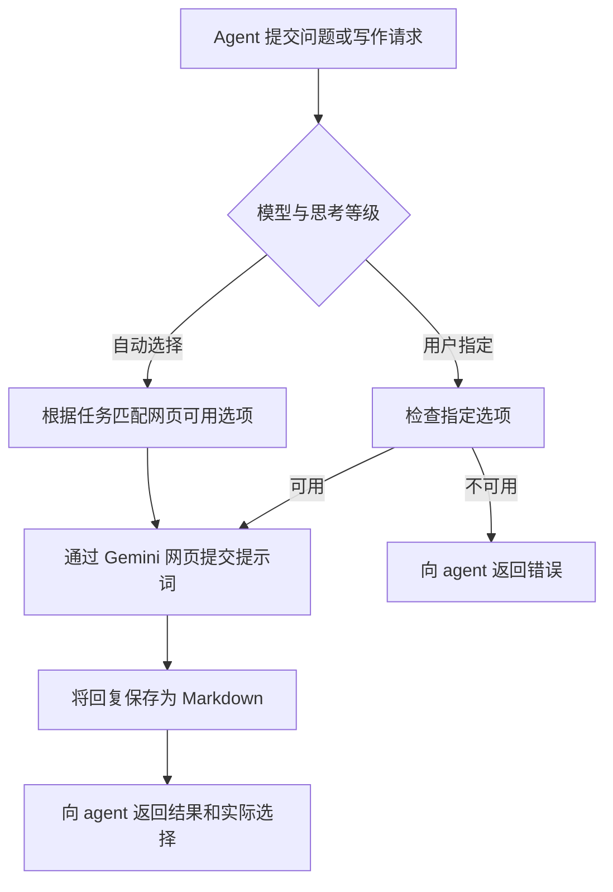

# ask-gemini-web

[English](README.md) | [简体中文](README.zh-CN.md) · [MIT](LICENSE)

让你的 agent 通过 Gemini 网页账号提问、写稿，自动选择模型并取回结果。

核心用途是把网页问答和写稿交给 Gemini，减少主 agent 的生成工作，节省 agent 套餐额度；也为所在地区不支持反重力（Antigravity）应用、但能正常使用 Gemini 网页的用户提供入口。任务仍使用 Gemini 网页额度，并受其使用资格限制；agent 的协调和结果处理仍可能消耗部分套餐额度。



## 让 agent 安装

把下面这句话发给你的 agent 即可。

> 请从 https://github.com/thweki/ask-gemini-web 安装 ask-gemini-web，通过我的 Gemini 网页账号写一篇关于城市花园的文章。请按任务选择模型和思考等级，需要我登录时再叫我。

agent 会负责准备环境并执行任务，你只需在所选 Chrome 浏览器的 Google 页面亲自登录。登录态保存在本地 profile 并在重启后复用，Google 偶尔仍可能要求验证。无需 API key，消耗 Gemini 网页额度。

## For agents · 给 agent

使用 Node.js 22.12 或更高版本，从 GitHub 克隆并安装：

```sh
git clone https://github.com/thweki/ask-gemini-web.git
cd ask-gemini-web
npm ci
npm run build
npm run install:skill
```

如果已经安装过，最后一步使用 `npm run install:skill -- --update`。加载 [SKILL.md](skills/ask-gemini-web/SKILL.md)，解析内置 runner 路径，并传入 UTF-8 JSON 任务文件执行一次调用（Windows 首选）：

```text
node <skill>/scripts/ask-gemini-web.mjs run job.json
```

```json
{"prompt":"写一篇关于城市花园的短文。"}
```

```text
draft({ prompt, model?, thinking?, task? }) → { id, state, promptSha256, result, selection }
```

未指定选项时，按任务和网页实时可用能力进行本地路由；显式指定参数时优先遵从，不可用则直接报错（如 `"model":"Gemini 4 Hydrogen","thinking":"medium"` 可同时锁定两项）。启动浏览器、选择配置、提交与保存均在该次调用内完成，无需额外的模型驱动浏览器循环。

`run --stdin` 保留给已确认支持 UTF-8 的管道。PowerShell 5.1 可能在 Node 收到输入前把中文静默替换为 `?`，因此 Windows 优先使用文件。返回的 `promptSha256` 对应最终渲染的提示词。`--compact`/`--json` 不向 stderr 输出进度；`--quiet` 隐藏人工模式的进度信息。

仅在需要时按需加载参考文档：[环境/API/恢复](skills/ask-gemini-web/references/api.md)、[路由策略](skills/ask-gemini-web/references/routing.md) 或[带日期的 benchmark 记录](skills/ask-gemini-web/references/benchmarks.md)。常规写稿前不要前置诊断调用。使用 `plan` 预览；提交状态不明时用 `resume <id>` 恢复原任务，切勿新建任务重发。本机 Chrome/CDP 访问走宿主常规权限流程。

依赖 Node.js 22.12+、Chrome 及 Gemini 访问权限。安装器会为 Codex 和 Agent Skills 目录配置独立运行时。profile 与任务数据仅留存本地，不包含在分发包中——切勿导出密码或 Cookie。

支持常规单轮文本与基础 Markdown，暂不支持 Canvas、Deep Research 工作流、二进制文件上传及逐字复现。实机测试环境为 Windows、Chrome 157 与 Gemini 中文界面，其他环境可能需要适配调整。基于 [MIT](LICENSE) 许可开源。

安装时只有显式传入 `--cdp` 或 CDP 环境变量才会在 skill 的 `connection.json` 中保存 `explicitCdp: true`；runner 仅为带此标记的地址传递 `--cdp`。普通安装只保存 home，旧版 `{ home, endpoint }` 未带 `explicitCdp` 的连接通过 `--remembered-cdp` 将端点作为首个隐式候选尝试，不可达时继续发现；`--update` 后仍保留此行为。更新会保留已有显式标记；取消固定地址的方法见 API 参考。

显式 CDP 地址（`--cdp`、`ASK_GEMINI_WEB_CDP` 或旧变量 `GEMINI_DRAFT_CDP` 回退）只连接指定浏览器；不可达时返回 `CDP_UNAVAILABLE`（退出码 2），不继续发现、不启动 Chrome、不改写 `connection.json`。请启动该地址上的 Chrome，或移除选项/环境变量以使用自动发现。隐式发现顺序为：记忆/配置端点 → 本机常用端口 9222、9333 → Chrome/Chromium 进程命令行提示（Linux/macOS/Windows）→ 常见及专用 profile 下的 `DevToolsActivePort` → 本机 Chrome/Chromium 拥有的 TCP 监听端口（Linux `/proc`，无需 `ss`）→ 启动专用 profile。首个端点按 `--remembered-cdp` → 所选 home 的 `connection.json` → 项目 `ask-gemini-web.config.json` / `gemini-draft.config.json` 的 `cdp` → 默认 `http://127.0.0.1:9222` 选择。Linux 进程参数同时支持 NUL 分隔和 Chrome 重写的空格拼接格式。仅接受本机 HTTP 地址，跳过重复或无效候选。

保留首个可达浏览器，即使尚未登录：`AUTH_LOGGED_OUT`（退出码 3）会报告端点，请运行 `ask-gemini-web login`，在同一个浏览器的 Google 页面手动登录，不会静默换成空 profile。已登录的 agent 浏览器通过**新标签页**复用，不聚焦或导航已有标签页；断开后保留 Chrome。结果已保存（包括导出待重试）或明确未发送时关闭任务标签页；发送不确定或采集未完成时保留原标签页供 `resume` 恢复。`google.com/sorry` 或 Google 页面出现 unusual traffic / 可疑流量 / 异常流量文案时返回 `AUTH_BLOCKED_SORRY`（退出码 3），并保留标签页；请在该浏览器手动完成验证，或使用已经登录的浏览器。工具不会解验证码或点击绕过。登录超时和 `login --no-wait` 都保留新标签页供人工登录。仅在使用隐式地址且没有可达 CDP 浏览器时才启动专用 `chrome-profile`；端口被占用时选择空闲回环端口，并以 0600 权限写入 `connection.json`。绝不复制或导出凭证、Cookie 或 profile；本机浏览器访问遵循宿主常规权限流程。

标准命令与 runner 为 `ask-gemini-web` 和 `scripts/ask-gemini-web.mjs`。旧 `gemini-draft` 命令与 runner 仍可使用，但会在 stderr 输出弃用提示；`--json`/`--compact` 的 stdout 保持可解析。仅在新文件不存在时读取 `gemini-draft.config.json`；仅在对应新变量未设置时读取 `GEMINI_DRAFT_CDP` / `GEMINI_DRAFT_HOME` / `GEMINI_DRAFT_CHROME`（runner 的 APP 变量同理）。

home 顺序：`--home` → 新/旧 HOME 环境变量 → 项目 `home` → 已存在的 `.ask-gemini-web` → 已存在的新平台目录 → 已存在的 `.gemini-draft` 或旧平台目录 → 新平台默认目录。平台默认值为 `~/.local/share/ask-gemini-web` 或 `%LOCALAPPDATA%\ask-gemini-web`（无 LOCALAPPDATA 时用用户目录）；旧目录使用 `gemini-draft`。若隐式项目 `home` 指向尚不存在的 `.ask-gemini-web` 或 `ask-gemini-web`，但同级 `.gemini-draft` 或 `gemini-draft` 已存在，则回退到旧目录并输出弃用提示；显式命令行/环境变量 home 路径始终优先。保留所选 home 的 `connection.json`、`chrome-profile` 和任务记录，不自动复制或迁移 profile。CDP 顺序为命令行 `--cdp` → 新/旧 CDP 环境变量 → `--remembered-cdp` → 所选 home 的 `connection.json` → 项目 `cdp` → 默认值。
