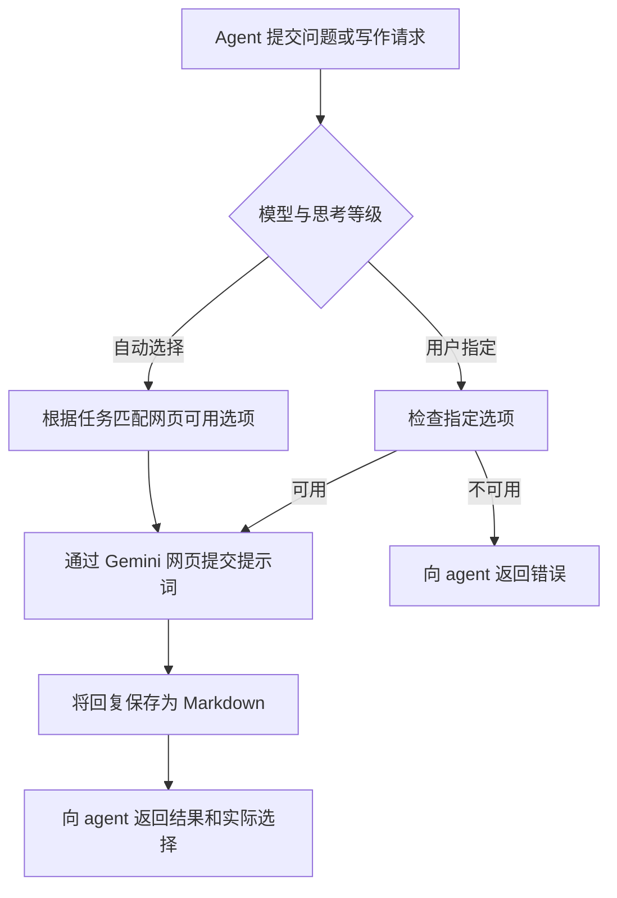

# ask-gemini-web

[English](README.md) | [简体中文](README.zh-CN.md) · [MIT](LICENSE)

让你的 agent 通过 Gemini 网页账号提问、写稿，自动选择模型并取回结果。

核心用途是把网页问答和写稿交给 Gemini，减少主 agent 的生成工作，节省 agent 套餐额度；也为所在地区不支持反重力（Antigravity）应用、但能正常使用 Gemini 网页的用户提供入口。任务仍使用 Gemini 网页额度，并受其使用资格限制；agent 的协调和结果处理仍可能消耗部分套餐额度。



## 让 agent 安装

把下面这句话发给你的 agent 即可。

> 请从 https://github.com/thweki/ask-gemini-web 安装 ask-gemini-web，通过我的 Gemini 网页账号写一篇关于城市花园的文章。请按任务选择模型和思考等级，需要我登录时再叫我。

agent 会负责准备环境并执行任务，你只需在专用 Chrome 的 Google 页面亲自登录。登录态保存在本地 profile 并在重启后复用，Google 偶尔仍可能要求验证。无需 API key，消耗 Gemini 网页额度。

## For agents · 给 agent

使用 Node.js 22.12 或更高版本，从 GitHub 克隆并安装：

```sh
git clone https://github.com/thweki/ask-gemini-web.git
cd ask-gemini-web
npm ci
npm run build
npm run install:skill
```

如果已经安装过，最后一步使用 `npm run install:skill -- --update`。加载 [SKILL.md](skills/ask-gemini-web/SKILL.md)，解析内置 runner 路径，并传入 UTF-8 JSON 任务文件执行一次调用（Windows 首选）：

```text
node <skill>/scripts/gemini-draft.mjs run job.json
```

```json
{"prompt":"写一篇关于城市花园的短文。"}
```

```text
draft({ prompt, model?, thinking?, task? }) → { id, state, promptSha256, result, selection }
```

未指定选项时，按任务和网页实时可用能力进行本地路由；显式指定参数时优先遵从，不可用则直接报错（如 `"model":"Gemini 4 Hydrogen","thinking":"medium"` 可同时锁定两项）。启动浏览器、选择配置、提交与保存均在该次调用内完成，无需额外的模型驱动浏览器循环。

`run --stdin` 保留给已确认支持 UTF-8 的管道。PowerShell 5.1 可能在 Node 收到输入前把中文静默替换为 `?`，因此 Windows 优先使用文件。返回的 `promptSha256` 对应最终渲染的提示词。`--compact`/`--json` 不向 stderr 输出进度；`--quiet` 隐藏人工模式的进度信息。

仅在需要时按需加载参考文档：[环境/API/恢复](skills/ask-gemini-web/references/api.md)、[路由策略](skills/ask-gemini-web/references/routing.md) 或[带日期的 benchmark 记录](skills/ask-gemini-web/references/benchmarks.md)。常规写稿前不要前置诊断调用。使用 `plan` 预览；提交状态不明时用 `resume <id>` 恢复原任务，切勿新建任务重发。本机 Chrome/CDP 访问走宿主常规权限流程。

依赖 Node.js 22.12+、Chrome 及 Gemini 访问权限。安装器会为 Codex 和 Agent Skills 目录配置独立运行时。profile 与任务数据仅留存本地，不包含在分发包中——切勿导出密码或 Cookie。

支持常规单轮文本与基础 Markdown，暂不支持 Canvas、Deep Research 工作流、二进制文件上传及逐字复现。实机测试环境为 Windows、Chrome 157 与 Gemini 中文界面，其他环境可能需要适配调整。基于 [MIT](LICENSE) 许可开源。
